# Vem Aí 🚌

> **Seu ônibus avisa quando está chegando.**
> Aplicativo para celular que manda uma notificação quando o ônibus que você pega todo dia está perto do seu ponto, ou quando ele some do rastreamento.

Trabalho da **APS da UNIP (Ciência da Computação)**, tema *"Desenvolvimento de uma aplicação de sistema distribuído para dispositivo móvel"*, na área de **trânsito e transporte público**.

---

## Sumário

1. [O problema e a solução](#1-o-problema-e-a-solução)
2. [O app em um minuto](#2-o-app-em-um-minuto)
3. [Por que é um sistema distribuído](#3-por-que-é-um-sistema-distribuído)
4. [Arquitetura: as peças](#4-arquitetura-as-peças)
5. [Fluxo 1: buscar um ponto e ver as previsões](#5-fluxo-1-buscar-um-ponto-e-ver-as-previsões)
6. [Fluxo 2: criar um alerta](#6-fluxo-2-criar-um-alerta)
7. [Fluxo 3: o monitor que dispara os avisos](#7-fluxo-3-o-monitor-que-dispara-os-avisos)
8. [Fluxo 4: quando uma parte cai](#8-fluxo-4-quando-uma-parte-cai)
9. [Fluxo 5: como os dados são coletados](#9-fluxo-5-como-os-dados-são-coletados)
10. [Tecnologias usadas e por quê](#10-tecnologias-usadas-e-por-quê)
11. [Telas do aplicativo](#11-telas-do-aplicativo)
12. [Roteiro para a apresentação](#12-roteiro-para-a-apresentação)
13. [Glossário](#13-glossário)
14. [Como rodar](#14-como-rodar)
15. [Referência técnica](#15-referência-técnica)

---

## 1. O problema e a solução

### O problema

Na Baixada Santista, as operadoras de ônibus têm um site chamado **"Quanto Tempo Falta?"**, que mostra quantos minutos faltam para cada ônibus chegar a um ponto. Ele tem três limitações:

| Limitação do site oficial | Consequência para o passageiro |
|---|---|
| Só responde quando você entra e atualiza a página | A pessoa fica abrindo o site várias vezes enquanto espera |
| Não percebe quando o ônibus some do GPS | A pessoa espera um ônibus que não vem |
| Não foi feito para celular | É difícil de usar na rua, com uma mão, sob sol |

### A solução

O **Vem Aí** faz o trabalho de olhar o site **por você**:

1. Você cadastra **uma vez** o ponto, a linha, o horário em que costuma pegar o ônibus e com quantos minutos de antecedência quer o aviso.
2. Perto desse horário, o sistema fica vigiando o ponto sozinho, a cada 30 segundos.
3. Quando o ônibus está chegando, seu celular recebe uma **notificação**, mesmo com o app fechado.
4. Se o ônibus que vinha **some do rastreamento** (provável perda de sinal de GPS), você também é avisado.

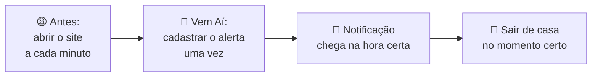

---

## 2. O app em um minuto

Este é o caminho do passageiro, do começo ao fim:

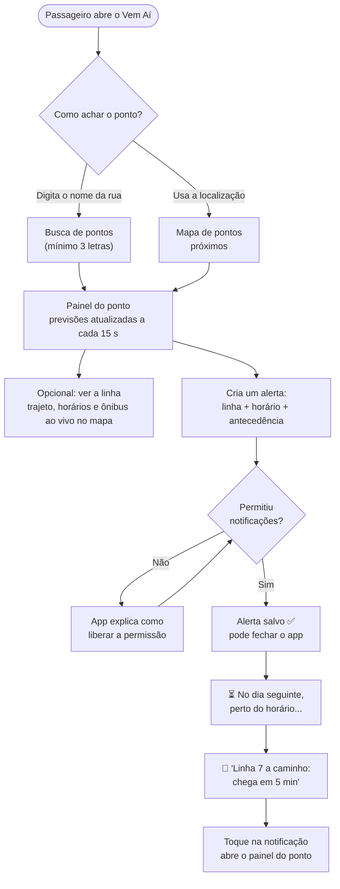

**Detalhes importantes:**

- **Não tem login nem cadastro.** O alerta fica ligado ao próprio celular.
- **O usuário nunca escolhe a empresa de ônibus.** Pontos e linhas das duas operadoras da região aparecem juntos.
- **Funciona como app instalado** (PWA): dá para adicionar à tela inicial, e abre mesmo sem internet (as previsões precisam de rede).

---

## 3. Por que é um sistema distribuído

Um **sistema distribuído** é um sistema formado por vários programas independentes, rodando em processos (ou máquinas) separados, que conversam pela rede para parecer, para o usuário, **um único sistema**.

O Vem Aí tem **quatro tipos de nó**, cada um com uma responsabilidade:

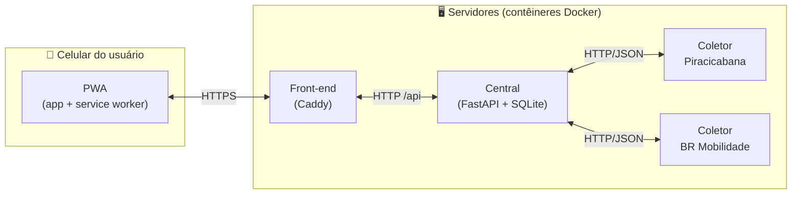

Como o projeto aplica os conceitos da disciplina:

| Conceito de sistemas distribuídos | Onde aparece no Vem Aí |
|---|---|
| **Processos independentes** | Front-end, central e coletores são programas separados, cada um no seu contêiner |
| **Comunicação por mensagens** | Todos conversam por HTTP com dados em JSON |
| **Transparência** | O usuário vê "os ônibus da região", sem saber que existem dois coletores e duas empresas |
| **Scatter-gather** (espalhar e juntar) | A central pergunta a todos os coletores **ao mesmo tempo** e junta as respostas |
| **Tolerância a falhas** | Se um coletor cai, o app continua funcionando com o outro e mostra um aviso |
| **Estado centralizado** | Só a central guarda dados (alertas e avisos enviados). Coletores não guardam nada importante, então podem reiniciar à vontade |
| **Escalabilidade** | Cada operadora nova é só mais um coletor, com a mesma imagem e outra URL |
| **Idempotência** | Rodar o monitor duas vezes não manda o mesmo aviso duas vezes (o banco impede) |
| **Comunicação assíncrona com o cliente** | A notificação push chega ao celular sem o app ter pedido nada (servidor → celular) |

---

## 4. Arquitetura: as peças

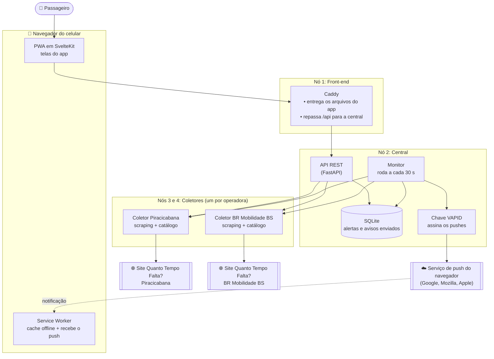

### O que cada peça faz, em uma frase

| Peça | O que faz | Guarda dados? |
|---|---|---|
| **PWA** | As telas que o usuário vê e toca | Só o cache do app e os pontos recentes |
| **Service Worker** | Programa que fica rodando no navegador em segundo plano: deixa o app abrir offline e mostra a notificação | Não |
| **Front-end (Caddy)** | Porta de entrada: entrega o app e repassa as chamadas `/api` para a central, tudo no mesmo endereço | Não |
| **Central** | O "cérebro": junta as respostas dos coletores, guarda os alertas e dispara as notificações | **Sim** (SQLite e chave VAPID) |
| **Coletor** | O "leitor": entra no site da operadora, lê o HTML e devolve dados limpos em JSON | Só um catálogo de pontos que se reconstrói sozinho |

> **Por que o front-end e a central ficam no mesmo endereço?** O push e o service worker exigem que o app e a API estejam na mesma origem (mesmo domínio). O Caddy resolve isso: o navegador só fala com ele, e ele repassa `/api` por dentro.

---

## 5. Fluxo 1: buscar um ponto e ver as previsões

O usuário digita "Conselheiro". A central pergunta aos **dois coletores ao mesmo tempo** (scatter) e junta as respostas (gather):

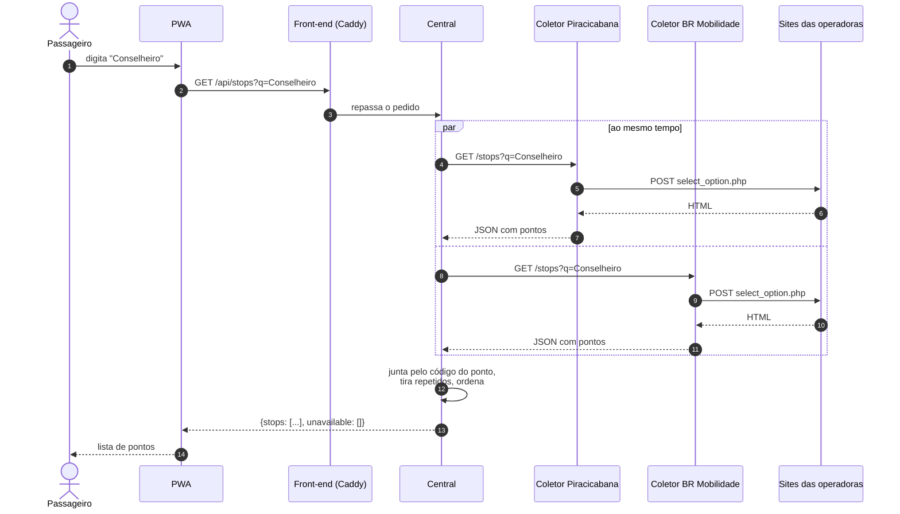

Ao tocar num ponto, o mesmo acontece com as previsões (`GET /api/stops/{id}/board`): a central junta os ônibus das duas operadoras e ordena **por quem chega primeiro**. A tela se atualiza sozinha a cada 15 segundos.

---

## 6. Fluxo 2: criar um alerta

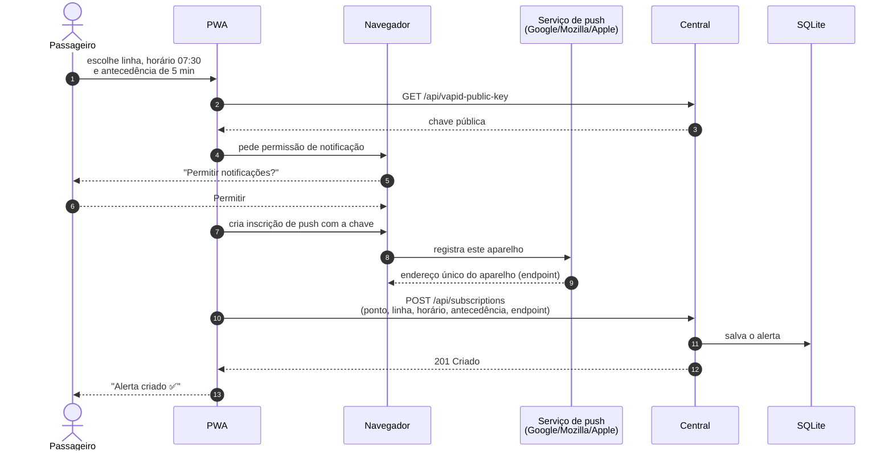

**O que é o `endpoint`?** É um endereço que o serviço de push do navegador cria para aquele celular. Quem tiver esse endereço (e a chave certa) consegue mandar notificação para ele. Por isso não precisa de login: o endpoint **é** a identidade do aparelho.

---

## 7. Fluxo 3: o monitor que dispara os avisos

Este é o coração do sistema. Dentro da central, um laço roda **a cada 30 segundos**:

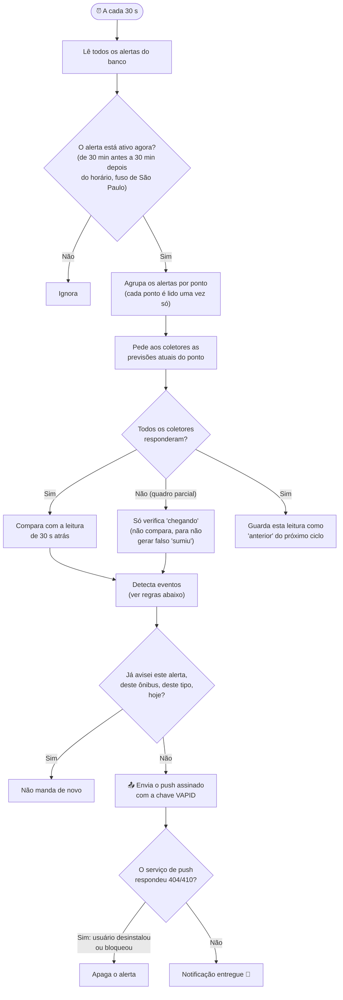

### As duas regras de aviso

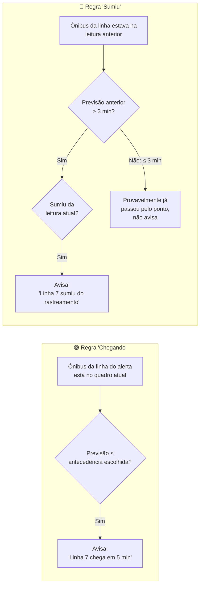

**Exemplo concreto.** Alerta: ponto 9306, linha 7, às 07:30, antecedência 5 min.

| Hora | O que o site mostra | O que o Vem Aí faz |
|---|---|---|
| 06:50 | Ônibus 1234 a 12 min | Nada: o alerta só fica ativo às 07:00 |
| 07:10 | Ônibus 1234 a 12 min | Alerta ativo, mas 12 > 5. Guarda a leitura |
| 07:10:30 | Ônibus 1234 a 8 min | Ainda não. Guarda a leitura |
| 07:11 | Ônibus 1234 a 5 min | 🔔 **"Linha 7 a caminho: chega em 5 min"** |
| 07:11:30 | Ônibus 1234 a 4 min | Nada: já avisou este ônibus hoje |

**E o caso do sumiço:** se às 07:11 o ônibus 1234 (que estava a 8 min) desaparece do quadro, o aviso é 🔔 **"Linha 7 sumiu do rastreamento. Última previsão: 8 min"**.

### Por que nunca chega aviso repetido

O banco tem uma tabela de notificações enviadas com **chave única** (alerta, ônibus, tipo, dia). O monitor tenta inserir a linha **antes** de enviar; se a linha já existe, a inserção falha e o push não sai. Isso torna o ciclo **idempotente**: rodar de novo, ou reiniciar a central, não duplica avisos.

---

## 8. Fluxo 4: quando uma parte cai

Os coletores dependem de sites de terceiros, que podem sair do ar. O sistema foi feito para **degradar com elegância** em vez de quebrar:

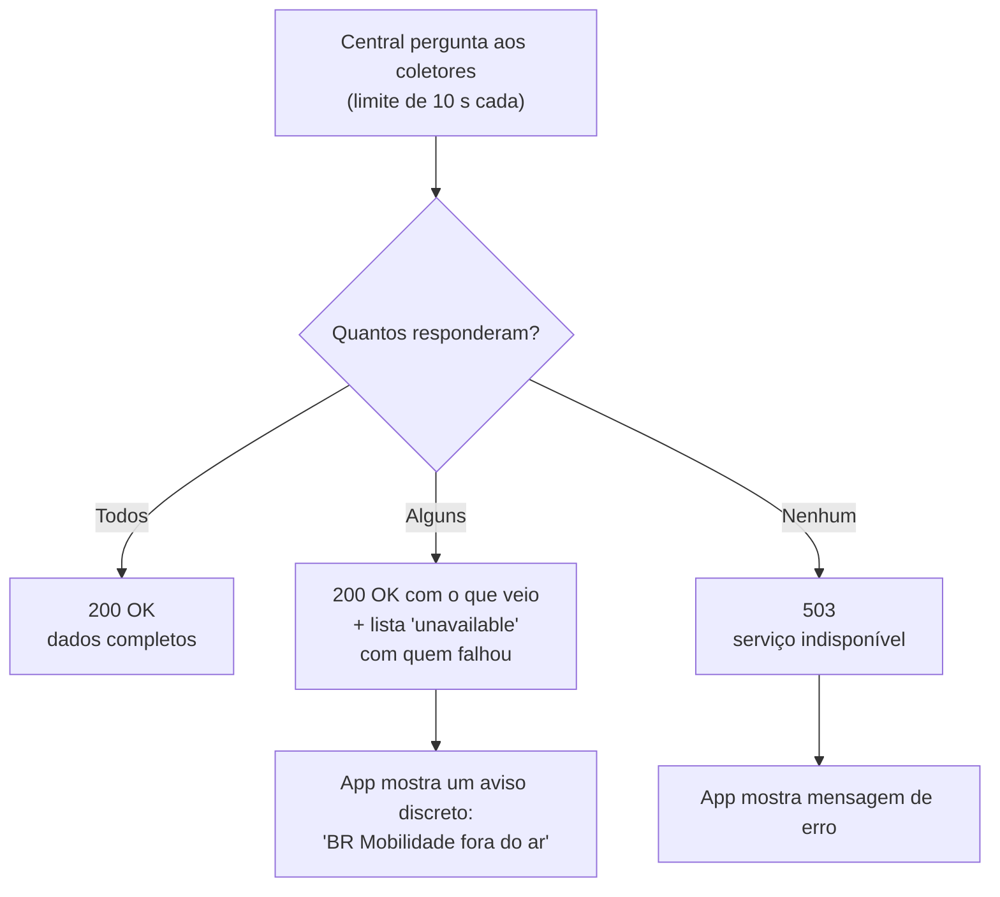

| Situação | O que o usuário vê |
|---|---|
| Os dois coletores funcionando | Tudo normal |
| Um coletor fora | Pontos e ônibus da outra operadora, mais um aviso de quem está fora |
| Os dois fora | Mensagem de erro |
| Sem internet no celular | O app abre (está em cache), mas sem previsões |

> **Cuidado especial no monitor:** se um coletor cai, os ônibus dele "somem" do quadro. Sem tratamento, isso dispararia avisos falsos de "sumiu". Por isso um quadro incompleto só serve para "chegando" e nunca é usado como leitura anterior.

---

## 9. Fluxo 5: como os dados são coletados

As operadoras **não têm API pública**. O coletor usa **web scraping**: faz o mesmo pedido que o navegador faria, recebe o HTML da página e extrai os dados com um parser.

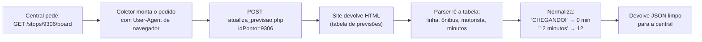

Os dois sites usam o **mesmo sistema**, então **um único parser** serve às duas operadoras. Cada coletor é a mesma imagem Docker com outra URL.

### Catálogo de pontos (para o mapa de "pontos perto de mim")

O site não sabe buscar pontos por localização. Então cada coletor monta, sozinho, um catálogo com todos os pontos e suas coordenadas:

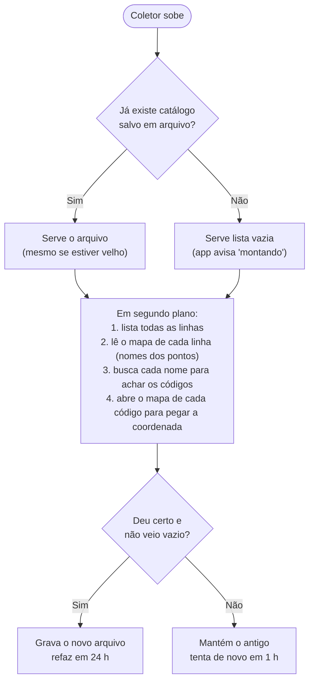

As consultas vão de três em três, com pausas, para não sobrecarregar o site da operadora.

---

## 10. Tecnologias usadas e por quê

| Camada | Tecnologia | Por que foi escolhida |
|---|---|---|
| App no celular | **PWA** (Progressive Web App) | Funciona em Android e iPhone com um só código, instala pela tela inicial, sem loja de apps |
| Interface | **SvelteKit** (Svelte 5) + **TypeScript** | Framework leve e rápido; TypeScript pega erros antes de rodar |
| Estilo | **Tailwind CSS v4** | Estilização rápida e consistente |
| Mapas | **Leaflet** | Mapas de pontos, trajeto da linha e ônibus ao vivo |
| Notificação | **Web Push** + **VAPID** | Padrão aberto dos navegadores para mandar notificação do servidor para o celular |
| Offline | **Service Worker** | Guarda o app em cache e recebe o push com o app fechado |
| Servidor web | **Caddy** | Entrega o app e faz proxy para a API no mesmo endereço |
| Back-end | **Python 3.12** + **FastAPI** | API rápida, assíncrona (faz vários pedidos ao mesmo tempo) e com validação automática |
| Scraping | **httpx** + **BeautifulSoup** | Cliente HTTP assíncrono para falar com os sites e leitura do HTML |
| Banco | **SQLite** | Banco em um arquivo, sem servidor extra; suficiente para o volume do projeto |
| Contêineres | **Docker** + **Docker Compose** | Sobe os 4 nós com um comando, igual em qualquer máquina |
| Implantação | **Dokploy** + Traefik | Publica com HTTPS automático (o push exige HTTPS) |
| Testes | **pytest** com HTML real dos sites | Garante que o parser continua funcionando |

---

## 11. Telas do aplicativo

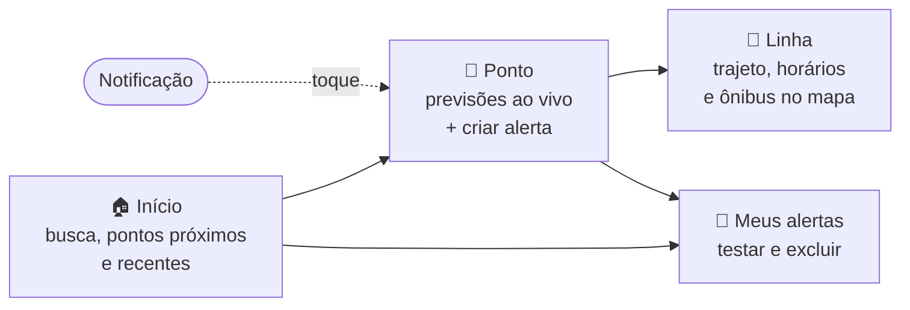

| Tela | Endereço | O que mostra |
|---|---|---|
| Início | `/` | Busca de pontos, mapa de pontos próximos e pontos recentes |
| Ponto | `/ponto/{código}` | Ônibus a caminho com minutos e motorista, atualiza a cada 15 s; formulário de alerta |
| Linha | `/linha/{id}` | Itinerário, traçado no mapa, tabela de horários e ônibus em tempo real |
| Alertas | `/alertas` | Alertas deste celular, com botão de testar a notificação e de excluir |

---

## 12. Roteiro para a apresentação

Sugestão de ordem para demonstrar em ~10 minutos:

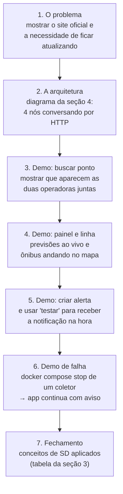

Comandos úteis para a demo de tolerância a falhas:

```sh
docker compose stop coletor-brmobilidadebs    # derruba um nó
# no app: os pontos continuam aparecendo, com o aviso de operadora fora do ar
docker compose start coletor-brmobilidadebs   # volta ao normal
```

---

## 13. Glossário

| Termo | Explicação simples |
|---|---|
| **PWA** | Site que se comporta como app: instala na tela inicial, abre offline e recebe notificação |
| **Service Worker** | Script que o navegador mantém rodando em segundo plano para o app |
| **Web Push** | Jeito padrão de um servidor mandar notificação para o navegador, mesmo com a página fechada |
| **VAPID** | Par de chaves que prova ao serviço de push que a notificação veio mesmo do nosso servidor |
| **Endpoint** | Endereço único de push de um celular; identifica o aparelho sem login |
| **Web scraping** | Ler dados de um site "como um navegador", extraindo do HTML |
| **Coletor** | Nosso serviço que faz o scraping de uma operadora |
| **Central** | Nosso serviço que junta tudo, guarda os alertas e manda os avisos |
| **Scatter-gather** | Mandar o mesmo pedido para vários serviços ao mesmo tempo e juntar as respostas |
| **Idempotente** | Operação que, repetida, não muda o resultado (não manda aviso duplicado) |
| **Snapshot** | "Foto" das previsões de um ponto num momento, usada para comparar com a próxima |
| **Proxy reverso** | Servidor que recebe o pedido e repassa para outro serviço por dentro |
| **`idLinha`** | Código fixo (hash) que o site usa para cada linha; o número exibido varia, este não |

---

## 14. Como rodar

Requer Python 3.12 ou mais novo, o [uv](https://docs.astral.sh/uv/), Node 24 e o [pnpm](https://pnpm.io/). Para o jeito mais simples, só o Docker.

### Jeito mais simples: Docker Compose

```sh
docker compose up --build
```

Abra http://localhost:8080 (mude com `FRONTEND_PORT`). Sobe o front-end, a central e os dois coletores. O front-end é o [Caddy](https://caddyserver.com/) servindo `frontend/build`, devolvendo `index.html` para qualquer rota do SPA e encaminhando `/api/*` para a central, então o PWA e a API ficam na mesma origem. A central não é publicada no host. O banco e a chave VAPID ficam no volume `central-data`.

### Desenvolvimento

```sh
scripts/dev.sh
```

O script sobe os coletores em `8001` e `8002`, a central em `8000` e o Vite em http://localhost:5173, que encaminha `/api` para a central. Abra http://localhost:5173. Se a porta 5173 estiver ocupada, o Vite usa a próxima e imprime o endereço.

Para rodar só uma parte: `cd backend && uv sync && uv run uvicorn vemai.central:create_app --factory` ou `cd frontend && pnpm install && pnpm dev`. O banco SQLite e a chave VAPID ficam em `data/`, relativo ao diretório onde a central roda (`backend/data`).

### Testar a notificação no celular

O Web Push só funciona em HTTPS ou em `localhost`. Para testar no celular, exponha o front-end (Compose, porta 8080) com um túnel HTTPS:

```sh
cloudflared tunnel --url http://localhost:8080
```

Abra o endereço `https://...trycloudflare.com` no celular. No iPhone é preciso tocar em Compartilhar, escolher "Adicionar à Tela de Início" e abrir o app por lá.

### Deploy no Dokploy

O arquivo `compose.dokploy.yaml` sobe o app inteiro no [Dokploy](https://dokploy.com/), sem portas publicadas no host.

1. Crie um serviço **Docker Compose** apontando para este repositório, com o caminho `compose.dokploy.yaml`. Use o modo padrão: o modo Stack não constrói imagens.
2. Na aba **Domains**, adicione o domínio no serviço `frontend`, porta `80`. O Traefik do Dokploy emite o certificado; o Web Push só funciona com HTTPS.
3. Opcional, na aba **Environment**: `VAPID_SUBJECT` (contato enviado aos serviços de push, padrão `mailto:admin@example.com`) e `MONITOR_INTERVAL_S`.

Os dados ficam em dois volumes nomeados, que entram no backup de volumes do Dokploy: `central` (banco dos alertas e chave VAPID; perder a chave invalida as inscrições de push) e `catalogos` (catálogo de pontos de cada operadora). No primeiro deploy os coletores montam o catálogo em segundo plano, em alguns minutos; até lá o mapa de pontos próximos avisa que está sendo montado.

As imagens instalam as dependências antes de copiar o código e usam cache do BuildKit para o uv e o pnpm, então um deploy que só muda código reaproveita as dependências. Os serviços Python rodam sem root.

### Testes

```sh
cd backend && uv run pytest
cd frontend && pnpm check
```

---

## 15. Referência técnica

O desenho completo, com todas as decisões, está em [docs/arquitetura.md](docs/arquitetura.md). As orientações da disciplina estão em [docs/aps-orientacoes-2020-2.pdf](docs/aps-orientacoes-2020-2.pdf).

### Estrutura do repositório

```
backend/    API em Python (FastAPI): central, coletores, testes, certificados e Dockerfile
  vemai/
    central.py     API da central e o monitor
    alerts.py      regras de "chegando" e "sumiu"
    push.py        envio do Web Push com VAPID
    db.py          banco SQLite
    collector.py   API do coletor
    scraper.py     leitura do HTML dos sites
    catalog.py     catálogo de pontos com coordenadas
    region.py      junção das respostas dos coletores
    models.py      formatos dos dados
  tests/           testes com HTML real dos sites (fixtures)
frontend/   PWA em SvelteKit, com Dockerfile e Caddyfile próprios
docs/       arquitetura e material da disciplina
scripts/    dev.sh (ambiente local) e make_icons.py
compose.yaml           Docker Compose para rodar local
compose.dokploy.yaml   Docker Compose para o deploy
```

Os dois lados só se falam pela API HTTP em `/api`. O backend não conhece o front-end.

### Variáveis de ambiente

| Variável | Serviço | Padrão | Descrição |
|---|---|---|---|
| `OPERATOR_BASE_URL` | coletor | (obrigatória) | URL base do site da operadora |
| `CATALOG_PATH` | coletor | `data/catalog-<host>.json` | Arquivo do catálogo de pontos com coordenadas, um por operadora |
| `COLLECTORS` | central | (vazia) | Lista `nome=url` separada por vírgulas |
| `MONITOR_INTERVAL_S` | central | `30` | Intervalo do monitor, em segundos |
| `DB_PATH` | central | `data/vemai.db` | Arquivo SQLite |
| `VAPID_SUBJECT` | central | `mailto:admin@example.com` | Contato enviado aos serviços de push |

A chave VAPID é gerada na primeira execução em `data/vapid_private.pem`.

### API da central

| Rota | Função |
|---|---|
| `GET /api/stops?q=` | Busca pontos em todos os coletores (mín. 3 letras). Devolve `{stops, unavailable}` |
| `GET /api/stops/catalog` | Todos os pontos da região com coordenadas, `{stops: [{id, name, lat, lng}], unavailable}` |
| `GET /api/stops/{stop_id}/board` | Previsões unidas de todas as operadoras, mais `unavailable` |
| `GET /api/lines?q=` | Busca linhas da região pelo nome ou número |
| `GET /api/lines/{line_id}?operator=` | Itinerário, traçado, pontos e horários da linha, com a operadora que a atende. 404 se nenhuma a conhece |
| `GET /api/lines/{line_id}/vehicles?operator=` | Posições ao vivo dos veículos da linha `[{prefix, driver, lat, lng, direction, seen_at}]`, sem cache |
| `GET /api/status` | `[{name, online}]` por coletor |
| `GET /api/vapid-public-key` | Chave pública VAPID |
| `POST /api/subscriptions` | Cria um alerta (ponto, linha, horário, antecedência) |
| `GET /api/subscriptions?endpoint=` | Lista os alertas deste aparelho |
| `DELETE /api/subscriptions/{id}?endpoint=` | Exclui um alerta |
| `POST /api/subscriptions/{id}/test?endpoint=` | Envia uma notificação de teste |

`unavailable` lista as operadoras cujo coletor falhou naquele pedido. Se todos falham, a resposta é 503.

### Front-end

SvelteKit (Svelte 5, TypeScript, Tailwind CSS v4) compilado como SPA estático com `adapter-static`, em `frontend/`.

| Caminho | Função |
|---|---|
| `src/routes/+page.svelte` | Início: busca de pontos, pontos próximos e recentes |
| `src/routes/ponto/[stopId]` | Painel do ponto, atualizado a cada 15 s, com o formulário de alerta |
| `src/routes/linha/[lineId]` | Detalhe da linha: itinerário, mapa, horários e veículos ao vivo |
| `src/routes/alertas` | Alertas deste aparelho, com testar e excluir |
| `src/lib/api.ts` | Cliente tipado da API da central |
| `src/lib/push.ts` | Permissão, inscrição Web Push e detecção de suporte |
| `src/lib/components/` | Componentes (cartões, busca, mapas, formulário, toast) |
| `src/service-worker/` | Cache do app para uso offline, recebimento do push e clique na notificação |
| `static/` | Manifesto e ícones (`scripts/make_icons.py` gera os PNG) |

Comandos: `pnpm check` (tipos), `pnpm build` e `pnpm preview`.

### Particularidades do scraping

- Sem um `User-Agent` de navegador os sites respondem `403`.
- Os servidores não enviam o certificado intermediário (GlobalSign Atlas R3 AlphaSSL CA 2026 Q2). O arquivo `backend/certs/globalsign-alphassl-2026q2.pem` é somado ao bundle do `certifi`, então a verificação TLS continua ligada.
- O rótulo da linha varia entre a tabela (`04`) e a lista de previsões acima de 20 min (`CIRCULAR 004`). O identificador estável é o hash `idLinha`.
- `CHEGANDO!` significa 3 minutos ou menos e vira previsão `0`.
- A busca de pontos exige pelo menos 3 letras.
- As previsões com ônibus identificado só vão até 20 min; acima disso o site dá apenas a lista de linhas.
